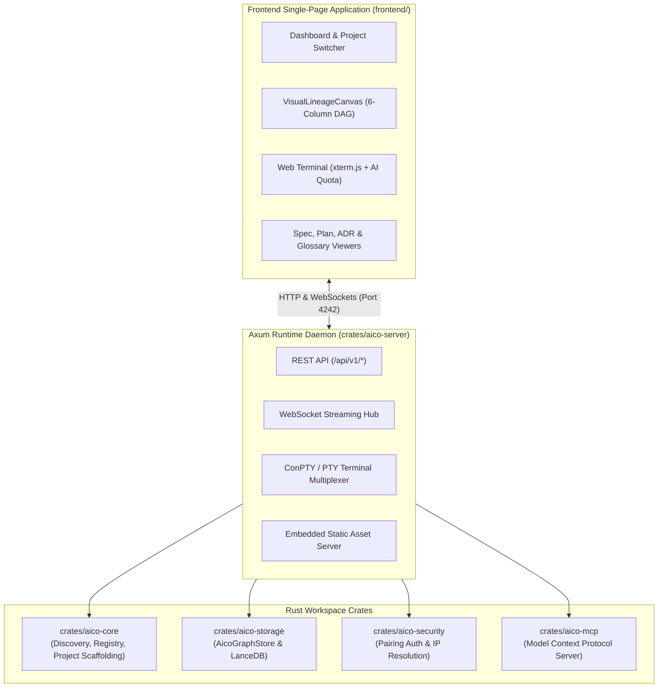

# AICO Engine & WebUI Shell (`aico`)

<!-- @implements spec-ft-repo-documentation-and-readmes::TASK-DOC-001-2::REQ-002::REQ-003 -->

> Zero-daemon, local-first Spec-Driven Development (SDD) platform, runtime daemon, embedded dual storage, and WebUI shell for autonomous AI coding agents.

`aico` is the primary codebase repository for **AICO (AI-Co-Development)**. It provides the embedded Rust runtime server, local storage engines, Model Context Protocol (MCP) tool gates, and the reactive single-page dashboard for inspecting, navigating, and orchestrating AI enabled Spec-Driven Development.

---

## 1. System Architecture

AICO is architected as a lightweight, zero-daemon workspace comprising an embedded multi-crate Rust backend and a modern React 19 frontend:



---

## 2. Workspace Crates

| Crate | Path | Responsibility |
| :--- | :--- | :--- |
| **`aico-core`** | [`crates/aico-core`](crates/aico-core) | Core domain types, workspace discovery, project manifest reader (`.aico-project.json`), and project scaffolding wizard (`CodebaseWizard`). |
| **`aico-storage`** | [`crates/aico-storage`](crates/aico-storage) | Dual embedded storage engine: zero-daemon native property graph (`AicoGraphStore`) supporting Cypher queries and multi-hop neighborhood traversal, plus vector indexing via `LanceDbVectorStore` for hybrid search. |
| **`aico-security`** | [`crates/aico-security`](crates/aico-security) | Token authorization, 3-tier security policy engine, local network IP resolution (LAN/VPN candidates), and pairing QR code authentication. |
| **`aico-mcp`** | [`crates/aico-mcp`](crates/aico-mcp) | Model Context Protocol server exposing native SDD tools to AI agents: `query_lineage_graph`, `search_hybrid`, `verify_task`, `validate_ears`, `extract_annotations`, and `find_dangling_requirements`. |
| **`aico-server`** | [`crates/aico-server`](crates/aico-server) | High-performance Axum web server and WebSocket daemon hosting terminal sessions, REST endpoints, and serving the embedded frontend single-page application. |

---

## 3. Frontend Application (`frontend/`)

The frontend is built with **React 19**, **TypeScript**, **Vite**, and **Tailwind CSS v4**:

- **Visual Lineage Graph Canvas ([`VisualLineageCanvas`](frontend/src/features/epic-hub/VisualLineageCanvas.tsx))**:
  - Interactive 6-column SVG directed acyclic graph: `ADR` $\to$ `Epic` $\to$ `Feature` $\to$ `Task` $\to$ `Code`.
  - Unified multi-tier cascading selection with active upstream provenance highlighting and downstream blast-radius filtering.
  - Cursor-centered focal point zooming and pan-drag gesture isolation.
- **ConPTY Web Terminal ([`TerminalConsole`](frontend/src/components/terminal/TerminalConsole.tsx))**:
  - Full-color interactive terminal powered by `@xterm/xterm` and `@xterm/addon-fit`.
  - Real-time AI token and rate-limit quota monitoring status indicator.
- **Workspace Navigation & Dashboard**:
  - One-click `+ New Project` creation wizard integrated into the project switcher.
  - Multi-repository Git status cards with state-aware action buttons and one-click AI conventional commits.
  - Markdown-rendered views for specs, implementation plans, ADRs, and ubiquitous domain terms.

---

## 4. Traceability & SDD Contract Annotations

Source code and tests in this repository maintain strict, bidirectional traceability to specifications declared in the decoupled [`aico-specs`](https://github.com/Lexer727/aico-specs) repository:

```typescript
// Tag public implementation symbols with the requirement they satisfy:
// @implements spec-ft-core-webui-shell::TASK-CORE-006-1::REQ-001
export function ShellLayout() { ... }

// Tag unit and seam test assertions with the requirement they verify:
// @verifies spec-ft-core-webui-shell::TASK-CORE-006-1::REQ-001
it('renders sidebar with navigation items', () => { ... });
```

---

## 5. Prerequisites & Environment Setup

- **Rust**: 2021 edition (Rust 1.80 or newer recommended) with `cargo`.
- **Node.js**: v20 or newer with `npm`.
- **Platform**: Windows (supported natively with Windows ConPTY), Linux, or macOS.

---

## 6. Build & Test Workflows

### Rust Workspace

```bash
# Check all workspace crates
cargo check --workspace

# Build the aico-server binary
cargo build -p aico-server

# Run workspace unit and integration tests
cargo test --workspace
```

### Frontend WebUI

```bash
# Install frontend dependencies
npm --prefix frontend install

# Build production bundle (compiled into frontend/dist/)
npm --prefix frontend run build

# Run Vitest unit and seam test suites (run inside frontend directory)
cd frontend
npm test
```

---

## 7. Running the Live Daemon

Launch the local AICO server:

```bash
# Run directly with Cargo
cargo run -p aico-server

# Or execute the compiled debug/release binary
./target/debug/aico-server.exe
```

When started, the daemon:
1. Binds to port `4242` on `0.0.0.0` (accessible locally at `http://localhost:4242`).
2. Serves the pre-compiled WebUI directly from `frontend/dist` with live-reload support.
3. Exposes the mobile pairing endpoint: `http://localhost:4242/api/v1/auth/pairing`.
4. Streams ConPTY terminal sessions over `ws://localhost:4242/api/v1/terminal/ws`.
5. Mounts the MCP tool server for local agent interactions.

---

## 8. Linked Repositories

- **Specifications Repository**: [`aico-specs`](https://github.com/Lexer727/aico-specs) — Formal EARS specifications, ADRs, engineering epics, and ubiquitous glossary.
- **Agent Skills**: [`aico-skills`](https://github.com/Lexer727/aico-skills) — Autonomous Spec-Driven Development skills and verification harness.

---

## 9. License

Dual-licensed under either:
- **MIT License** ([LICENSE-MIT](LICENSE-MIT) or http://opensource.org/licenses/MIT)
- **Apache License, Version 2.0** ([LICENSE-APACHE](LICENSE-APACHE) or http://www.apache.org/licenses/LICENSE-2.0)
